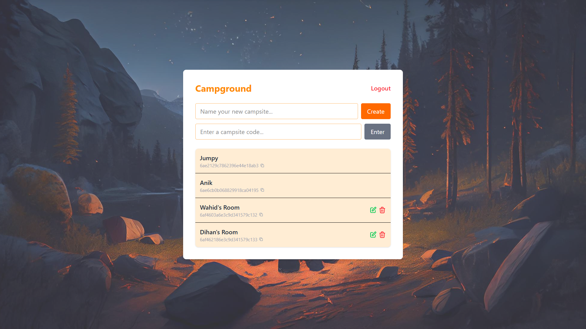
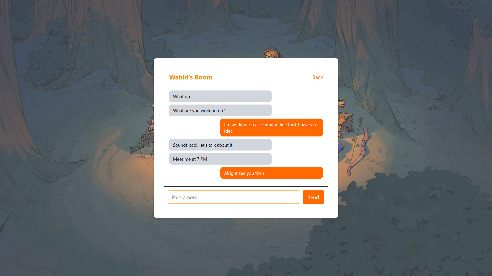

# Campfire

A real time chat application where people create or join rooms and talk instantly. I built it with React, Express, Socket.io and MongoDB, with authentication and access control handled on the server.

[](https://github.com/Stray3rdBorn/messaging-app/actions/workflows/ci.yml)
[](LICENSE)

**Live demo:** https://campfire-dcsw.onrender.com

> The demo runs on Render's free plan, which puts the server to sleep after 15 minutes of inactivity. The first request after a break can take a short while to wake it up.

## Screenshots

| Rooms page                                | Chat room                               |
| ----------------------------------------- | --------------------------------------- |
|  |  |

## About

I built Campfire to get hands on with the web stack: React on the frontend, Express and MongoDB on the backend, and real time communication over WebSockets. Along the way it grew into a project about doing the boring parts properly: verifying who a user is, checking what they are allowed to do, and handling errors without leaking details.

## Features

- Sign up and log in with JWT authentication (tokens last 7 days)
- Passwords hashed with bcrypt
- Create rooms, and join existing rooms by pasting the room ID
- Real time messaging with Socket.io, so messages appear for everyone in the room instantly
- Message history saved in MongoDB and loaded when a room opens
- Room creators can rename and delete their rooms, and deleting a room also deletes its messages
- Room name shown in the chat header
- Logout
- Interface styled with Tailwind CSS
- Dockerfiles, a docker compose file and a GitHub Actions CI workflow
- Deployed on Render, with Express serving the built React app

## Tech Stack

| Layer          | Technology                                                           |
| -------------- | -------------------------------------------------------------------- |
| Frontend       | React (Vite), React Router, Axios, Socket.io Client, Tailwind CSS v4 |
| Backend        | Node.js, Express 5, Socket.io                                        |
| Database       | MongoDB (Atlas) with Mongoose                                        |
| Authentication | JWT (jsonwebtoken), bcryptjs                                         |
| DevOps         | Git and GitHub, GitHub Actions, Docker, Render                       |
| Tools          | VS Code, Postman                                                     |

## How It Works

1. **Login.** On signup the server hashes the password with bcrypt. On login it compares the typed password with the stored hash, then returns a signed JWT. The browser keeps the token in localStorage.
2. **Protected requests.** Every request to a protected route sends the token in the Authorization header. An auth middleware verifies it and attaches the user ID to the request.
3. **Rooms.** Creating a room makes the creator its first member. Anyone else joins by pasting the room ID, which adds their user ID to the room's members list.
4. **Opening a room.** The browser loads the history over REST, and the server checks membership first. It then opens a Socket.io connection with the token in the handshake, and the server verifies the token before accepting the connection. The browser asks to join the room, and the server checks membership again before adding the connection to it.
5. **Sending a message.** The browser sends the room ID and the text. The server validates the input, takes the sender from the verified token, saves the message to MongoDB, and broadcasts it to everyone in the room.

In production, Express serves the built client from `client/dist` with a catch all route for React Router, so one service hosts both the API and the interface. In development, the Vite dev server proxies API and socket traffic to the backend. API URLs are relative, so no CORS setup is needed.

## Folder Structure

```
messaging-app/
├── .github/workflows/ci.yml   # GitHub Actions CI
├── client/                    # React frontend (Vite)
│   ├── src/
│   │   ├── pages/             # Login, Signup, Rooms, Chat
│   │   └── App.jsx            # Routes
│   └── Dockerfile
├── server/                    # Express backend
│   ├── middleware/            # JWT auth middleware
│   ├── models/                # User, Room, Message (Mongoose schemas)
│   ├── routes/                # auth, rooms, messages
│   ├── index.js               # Entry point and Socket.io logic
│   └── Dockerfile
├── docker-compose.yml
├── LICENSE
└── README.md
```

## Getting Started

**Prerequisites:** Node.js, npm, and a MongoDB connection string (a free MongoDB Atlas cluster or a local MongoDB).

```bash
git clone https://github.com/Stray3rdBorn/messaging-app.git
cd messaging-app
```

**Backend**

```bash
cd server
npm install
```

Create a `.env` file inside `server/`:

```
PORT=5000
MONGO_URI=your_mongodb_connection_string
JWT_SECRET=your_long_random_secret
```

Then start it:

```bash
npm run dev
```

**Frontend** (in a second terminal)

```bash
cd client
npm install
npm run dev
```

Open http://localhost:5173. Both servers must run at the same time: the backend on port 5000 and the frontend on port 5173.

## Docker

Dockerfiles for the client and the server and a docker compose file are included:

```bash
docker compose up --build
```

I could not run Docker on my own machine, so these files have not been tested locally.

## Deployment

The app runs as a single Node web service on Render. The React app is built once, and Express serves it alongside the API. `MONGO_URI` and `JWT_SECRET` are set as environment variables in the Render dashboard, and every push to `main` triggers an automatic deploy. The database is a free MongoDB Atlas cluster.

## API Reference

**Auth** (public)

| Method | Endpoint           | Purpose                  |
| ------ | ------------------ | ------------------------ |
| POST   | `/api/auth/signup` | Create an account        |
| POST   | `/api/auth/login`  | Log in and receive a JWT |

**Rooms** (JWT required)

| Method | Endpoint              | Purpose                                       |
| ------ | --------------------- | --------------------------------------------- |
| GET    | `/api/rooms`          | List the rooms you belong to                  |
| GET    | `/api/rooms/:id`      | Get one room (members only)                   |
| POST   | `/api/rooms`          | Create a room                                 |
| POST   | `/api/rooms/:id/join` | Join a room by ID                             |
| PUT    | `/api/rooms/:id`      | Rename a room (creator only)                  |
| DELETE | `/api/rooms/:id`      | Delete a room and its messages (creator only) |

**Messages** (JWT required)

| Method | Endpoint                | Purpose                             |
| ------ | ----------------------- | ----------------------------------- |
| GET    | `/api/messages/:roomId` | Load message history (members only) |

**Socket.io events**

| Event            | Direction         | Payload                                          |
| ---------------- | ----------------- | ------------------------------------------------ |
| connection       | Client to server  | Token sent in the handshake, rejected if invalid |
| `joinRoom`       | Client to server  | Room ID, accepted only for members               |
| `sendMessage`    | Client to server  | `{ roomId, text }`                               |
| `receiveMessage` | Server to clients | The saved message                                |

## Security

**Implemented**

- JWT authentication on REST routes and on the Socket.io handshake. A connection without a valid token is rejected before it opens.
- Passwords hashed with bcrypt and never stored in plain text.
- Access control on rooms. Membership is checked before message history is returned and before a connection can join a live room, and only the creator can rename or delete a room. This stops people from reading or posting in rooms they never joined just by knowing an ID.
- The message sender comes from the verified token, never from the client, so a user cannot send a message as somebody else.
- Validation on socket messages: the type is checked, the text is trimmed, and empty messages and messages over 1000 characters are rejected.
- Error handling that does not leak details. Socket handlers are wrapped in try/catch so one bad request cannot crash the server, and the history route returns a generic message while the real error goes only to the server log.
- Secrets live in environment variables.
- HTTPS comes from Render, and MongoDB Atlas encrypts database connections in transit.

**Not built yet**

- Rate limiting on login, signup and messages, to slow down brute force and spam.
- Stricter validation on the REST routes (types, formats, password rules).
- The same generic error responses on every REST route.
- Security headers with Helmet.
- Token storage. The JWT sits in localStorage, which any injected script could read. httpOnly cookies would be safer, and there are no refresh tokens or token revocation yet.
- Room IDs work as invitations, and MongoDB IDs are partly predictable. A separate long random invite code is the planned fix.
- Dependency auditing with npm audit and Dependabot.
- Atlas network access is open to all IPs because Render's free plan has no fixed outbound address. The database is still protected by credentials, and a database user with the least privileges needed is the recommended follow up.

## Testing and CI

GitHub Actions runs the CI workflow on every push. There is no automated test suite yet. I tested the REST routes with Postman and the real time flow in the running app.

## Known Limitations

- A message the server refuses does not show an error to the sender.
- A user who is not a member of a room sees an empty chat instead of an explanation.
- Loading, empty and error states are minimal across the interface.

## Roadmap

- Friend list
- Private messages between two users
- User dashboard with name, friends and a profile picture
- Invite codes for rooms
- Rate limiting and the other open security items above

## License

MIT. See [LICENSE](LICENSE).

## Author

Md Wahidul Islam ([Stray3rdBorn](https://github.com/Stray3rdBorn)). Website: https://wahidihan.vercel.app
